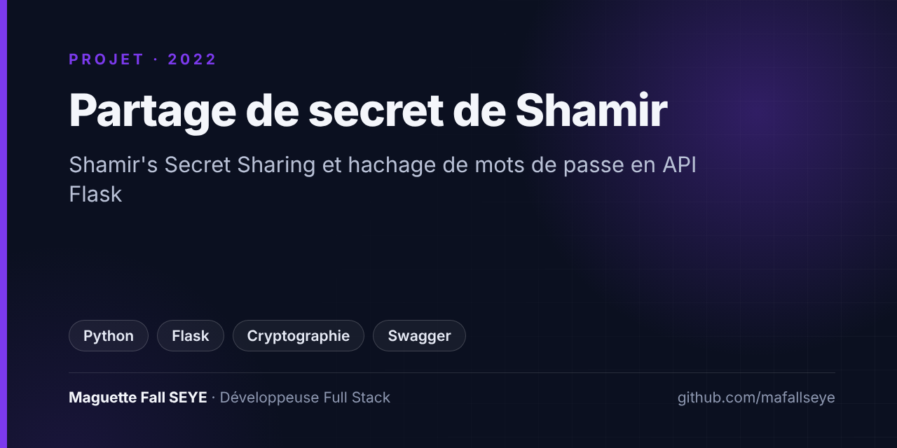

<p align="center"></p>

# Partage de secret de Shamir

Partage de secret de Shamir (SSS) et hachage de mots de passe exposés en API Flask.

## Fonctionnalités

- Découpage d'un secret en parts et reconstruction (Shamir)
- Chiffrement et hachage de mots de passe
- Routes d'API documentées avec Swagger

## Technologies

Python · Flask · Cryptographie · Swagger

## Lancer le projet

Prérequis : Python 3.9 ou plus.

```bash
git clone https://github.com/mafallseye/sssa.git
cd sssa
python -m venv .venv
source .venv/bin/activate   # Windows : .venv\Scripts\activate
pip install -r requirements.txt
cp .env.example .env         # puis renseigner les valeurs et les charger dans le terminal
python main.py
```

## Configuration

Aucun identifiant n'est écrit dans le code : les accès (base de données, e-mail, clés de signature) sont lus dans des variables d'environnement. La liste est dans [`.env.example`](.env.example).

> Projet réalisé en 2022 pendant ma formation. Il est conservé ici comme trace de mon parcours.

## Auteure

**Maguette Fall SEYE** — Développeuse Full Stack, Dakar (Sénégal) · [github.com/mafallseye](https://github.com/mafallseye)
